# Windows Fix

Collection of tools for enhancing the Windows experience :)

| App | What it does |
|-----|--------------|
| [Services Manager (SM)](#services-manager-sm) | Manage Windows services and startup apps |
| [NetSentry (NS)](#netsentry-ns) | Real-time network monitoring and traffic shaping |
| [Music Visualizer (MV)](#music-visualizer-mv) | GPU-accelerated real-time audio visualizer |

## Download

Grab the latest builds from **[Releases → Latest](https://github.com/Loafer19/WindowsFix/releases/latest)**

| File | Description |
|------|-------------|
| `ServicesManager_<version>-setup.exe` | Services Manager installer (recommended, receives auto-updates) |
| `ServicesManager_<version>-portable.exe` | Services Manager single exe, no install |
| `NetSentry_<version>-setup.exe` | NetSentry installer (recommended, receives auto-updates) |
| `NetSentry_<version>-portable.exe` | NetSentry single exe, no install |
| `MV_<version>.exe` | Music Visualizer, single exe |
| `SHA256SUMS.txt` | Checksums for every exe in the release |

All three apps are Windows 10/11 x64 only. Services Manager and NetSentry need to run as Administrator to change services / capture traffic

### Auto-update

Services Manager and NetSentry check for a new version on startup and offer to install it.
You can also check manually: **Check for updates** next to the tabs in Services Manager, or **Configs → Settings → Version** in NetSentry.
Nothing is installed without confirmation

- Updates are downloaded from this repository's latest GitHub release (`sm-latest.json` / `ns-latest.json`)
- Every update package is signed with the project's updater key and the app refuses packages with a wrong signature
- The update runs the NSIS installer, so a portable exe that updates itself becomes an installed copy
- Builds published before the first `v2026.*` release don't contain the updater, install a `v2026.*` build once by hand to start receiving updates

### Windows SmartScreen and antivirus warnings

The executables are **not code-signed** yet (a code-signing certificate costs money and none is configured), so:

- **SmartScreen** may show "Windows protected your PC" on first launch. Click **More info → Run anyway** if the file's checksum matches (see below)
- **NetSentry** ships the [WinDivert](https://reqrypt.org/windivert.html) packet-capture driver (`WinDivert64.sys`). WinDivert is a legitimate, signed open-source driver, but since it can intercept and modify network traffic it is also used by some malware, so several antivirus engines flag any app that bundles it as a "potentially unwanted" or "risky" tool. This is a heuristic, not a detection of malicious code in NetSentry
- All binaries are built by GitHub Actions from the source in this repository, see the release's workflow run linked from the [Actions tab](https://github.com/Loafer19/WindowsFix/actions/workflows/build-release.yml)

#### Verify a download

Each release contains `SHA256SUMS.txt` (also printed in the release notes). In PowerShell:

```powershell
Get-FileHash .\NetSentry_0.3.0-setup.exe -Algorithm SHA256
# compare the hash with the matching line in SHA256SUMS.txt
```

### Releases and versioning

- Each app keeps its own version in its `Cargo.toml` (`MV/Cargo.toml`, `SM/src-tauri/Cargo.toml`, `NS/src-tauri/Cargo.toml`). The Tauri apps take their version from `Cargo.toml`, so there is a single place to bump it
- A push to `main` publishes a release only when at least one app version differs from the current latest release. Releases can also be started manually from the Actions tab (`workflow_dispatch`, with a *force* option)
- Release tags are repository-level CalVer: `vYYYY.M.N` (for example `v2026.11.0`, then `v2026.11.1`), every release contains the full set of apps and becomes **Latest**. The old `v0.x` tags were tied to a single app's version and are kept for history

## Services Manager (SM)

Rust(Tauri) + Vue3 application to manage Windows Services

### Features

- Control service states and startup types
- **Presets** for quick configuration management
- Startup apps manager (registry Run keys and Startup folders)
- Filtering and search capabilities
- Service details modal with full information and AI insights
- History of every change made to services and startup apps
- Built-in auto-update
- Dark theme with responsive design

### Tabs

- Services (Filters)
    - Complete list of Windows services with status indicators
    - Filter services by status, startup type, and name
    - Quick Actions: Start, stop, restart, disable, or enable services
    - Service details modal with AI-generated explanations
- Presets
    - Apply presets to quickly change multiple services' configurations
- Startup Apps
    - List programs that start with Windows, filter by location and status
    - Enable, disable, add or remove startup entries
- History
    - Track changes made to services and startup apps, filter by type, clear history

| Services | Presets | History |
|-------|-------|-------|
| 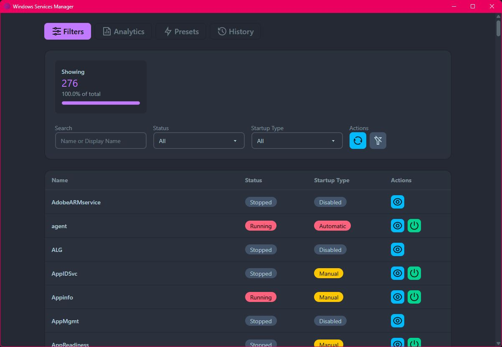 | 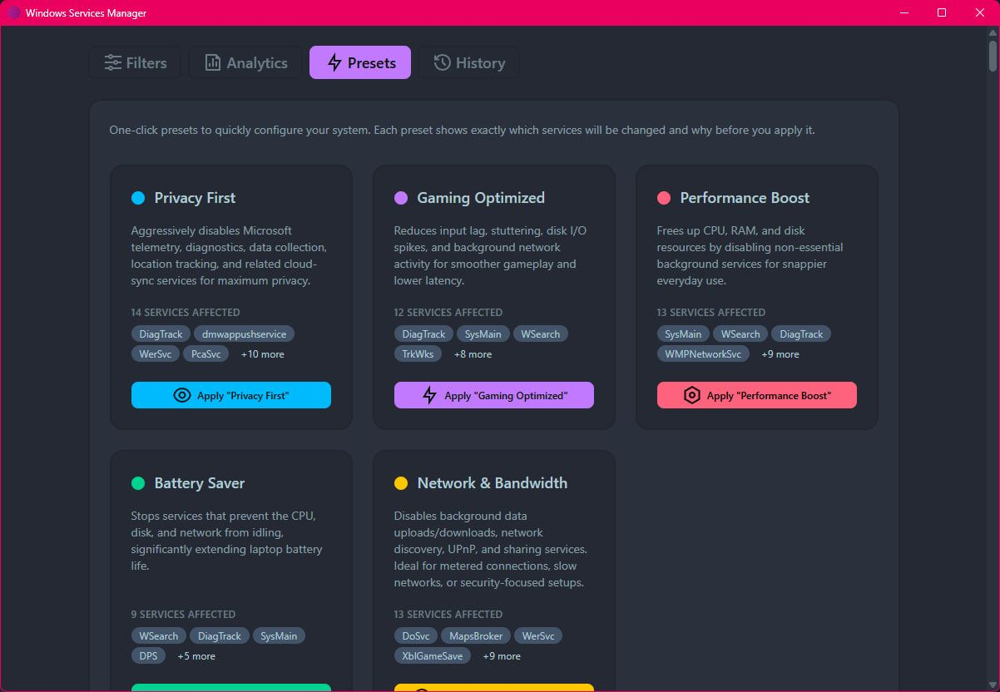 | 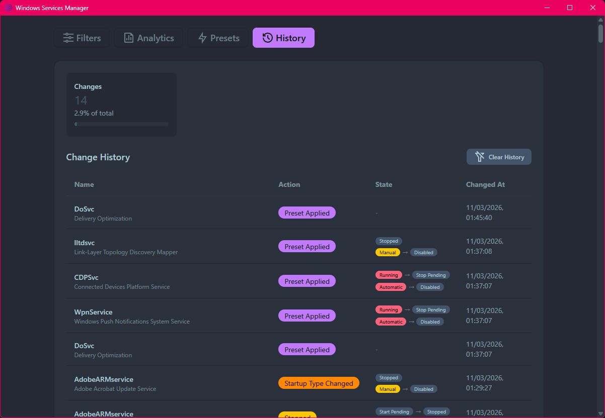 |

| Service Details Modal | Preset Application Confirmation |
|-------|-------|
| 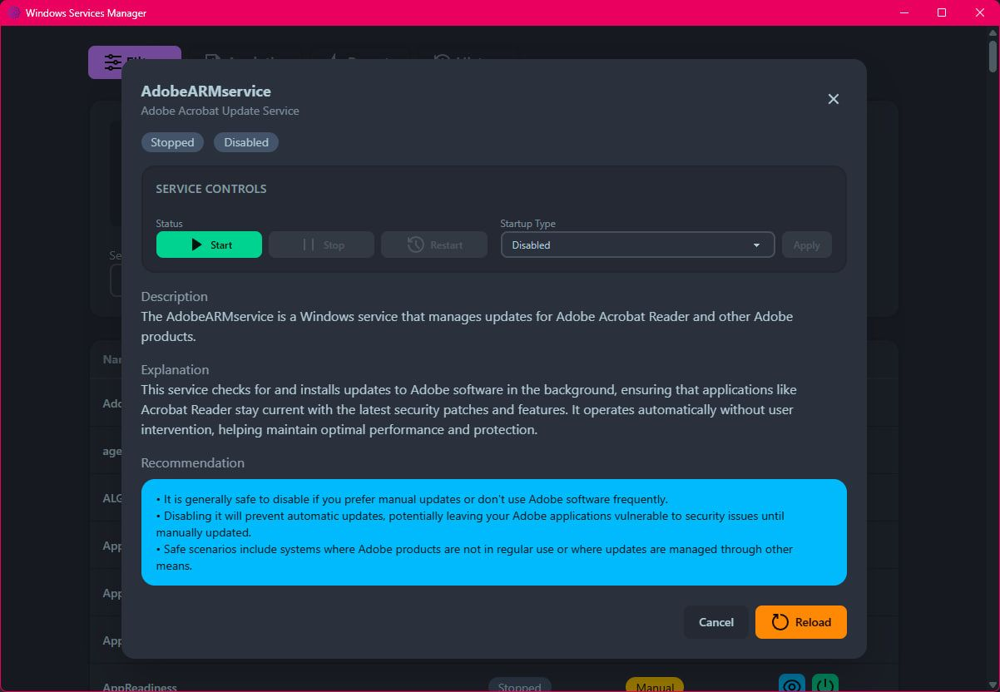 | 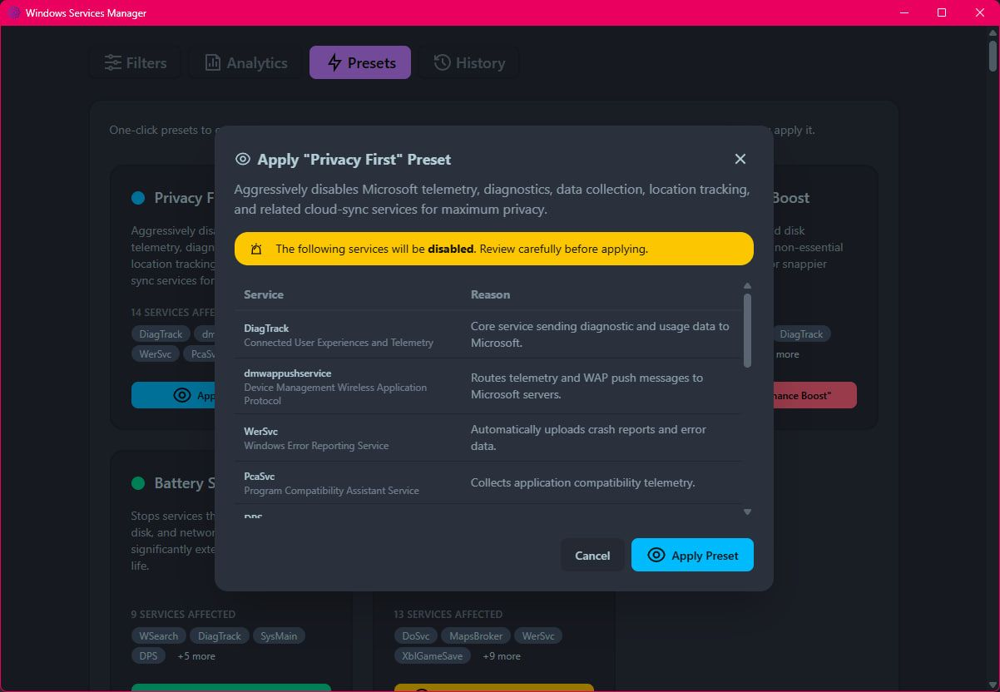 |

## NetSentry (NS)

A Tauri + Vue3 application for real-time network monitoring and traffic shaping

### Features

- Real-time network traffic statistics and process-level breakdown
- Traffic control: block, throttle, and terminate processes
- Notifications and alerts for new processes and data thresholds
- System tray integration with autorun options
- Advanced packet interception using WinDivert
- Persistent settings and SQLite-based storage
- Built-in auto-update
- Dark theme with responsive design

### Tabs

- Dashboard
    - Live network traffic statistics (download/upload speeds)
    - Process-level traffic breakdown with detailed per-application usage
    - 24-hour historical data tracking with hourly granularity and interactive charts
- Processes
    - View live bandwidth usage per application
    - Block network access for specific processes
    - Set custom bandwidth limits
    - Terminate processes directly from the interface
- Configs
    - Notification settings for new processes and data thresholds
    - Global bandwidth limits
    - Startup behavior (autorun, minimize to tray)
    - Data retention preferences
    - Version info and **Check for updates**
    - WinDivert driver status, install and start

| dashboard | processes | configs | configs |
|-------|-------|-------|-------|
| 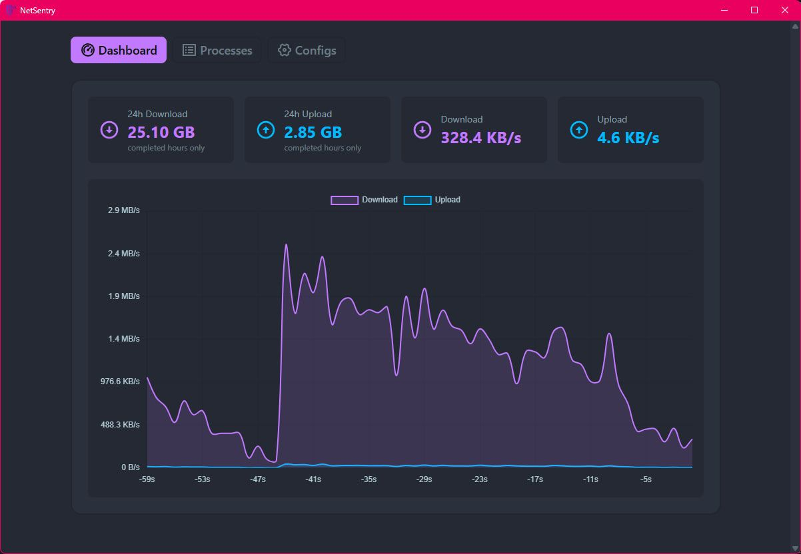 | 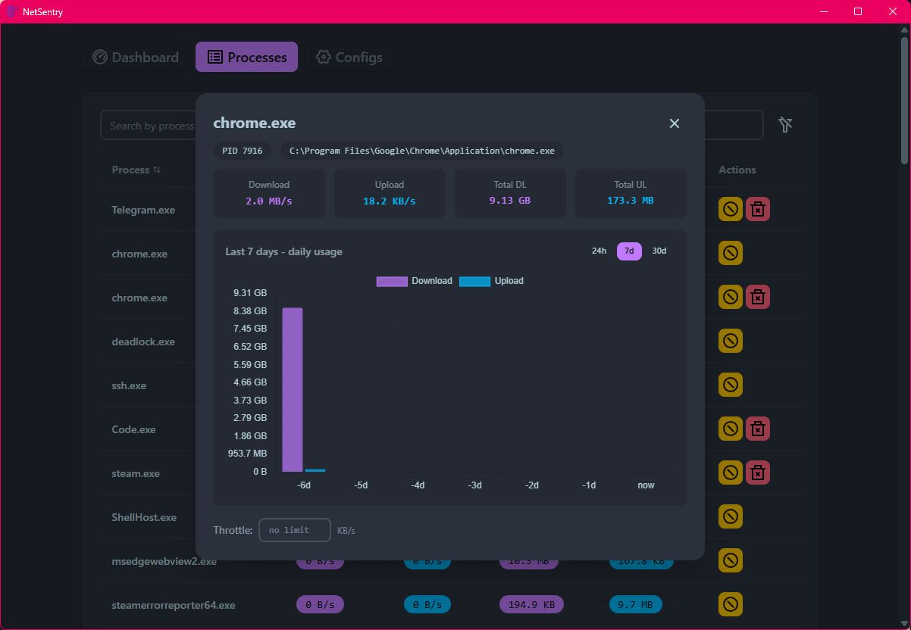 | 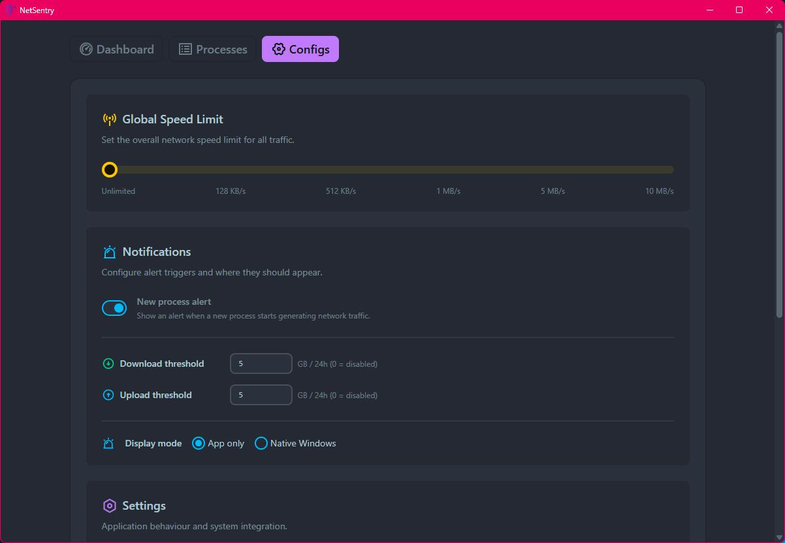 | 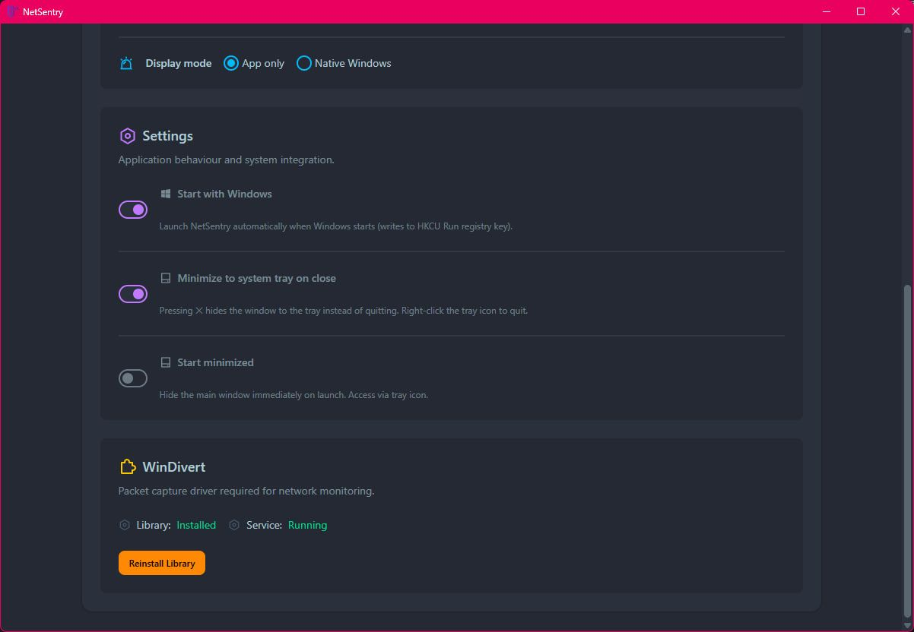 |

## Music Visualizer (MV)

A Rust application that visualises audio in real time using GPU-accelerated WGSL shaders (wgpu + egui)

### Features

- 23 visualisations across 4 groups: spectrum (bars, circular, heatmap, kaleidoscope …), waveform (oscilloscope, neon pulse, history …), abstract (mandala, plasma sphere, tunnel, ripple …) and 3D geometry (cubes, terrain, water droplets …)
- GPU compute particle system overlay
- Real-time beat detection with adjustable sensitivity
- Audio device selection with persistence (`settings.json` next to where MV is started)
- Window modes: normal, transparent and click-through overlay
- Fullscreen support
- Adjustable intensity, gain, opacity and beat sensitivity
- Settings panel with color schemes and effect toggles
- Shader browser and auto-switch mode with customizable intervals
- Single portable exe, all shaders are embedded

### Keyboard shortcuts

| Key | Action |
|-----|--------|
| `Space` / `M`, `Shift+Space` | Next / previous visualisation |
| `T` | Cycle window mode: normal → transparent → overlay |
| `←` / `→` | Decrease / increase opacity |
| `↑` / `↓` | Increase / decrease intensity |
| `B` | Cycle beat sensitivity |
| `F11` | Toggle fullscreen |
| `F1` | Toggle help / info panel |
| `F2` | Settings |
| `F3` | Audio device selector |
| `F4` | Shader browser |
| `Esc` | Exit fullscreen or quit |

| plasma_sphere_3d | oscilloscope | depth_wave_3d |
|-------|-------|-------|
| 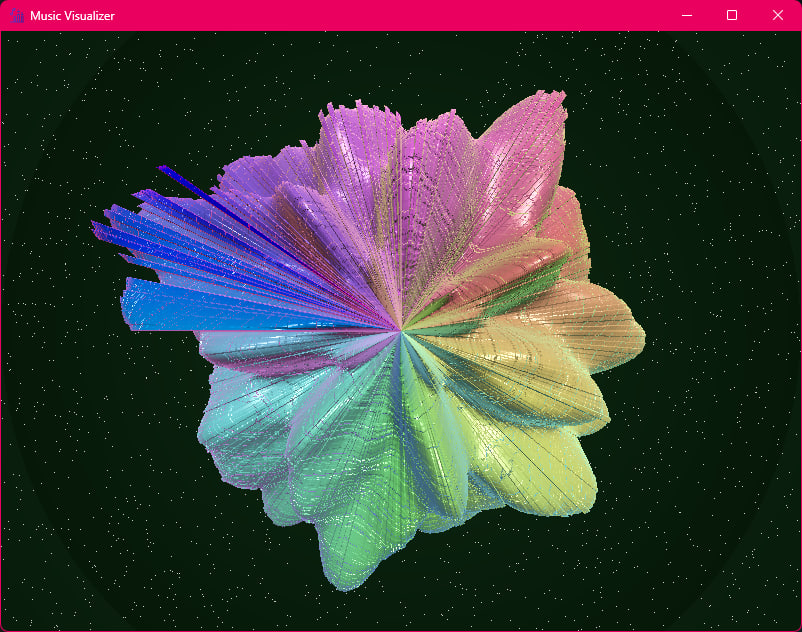 | 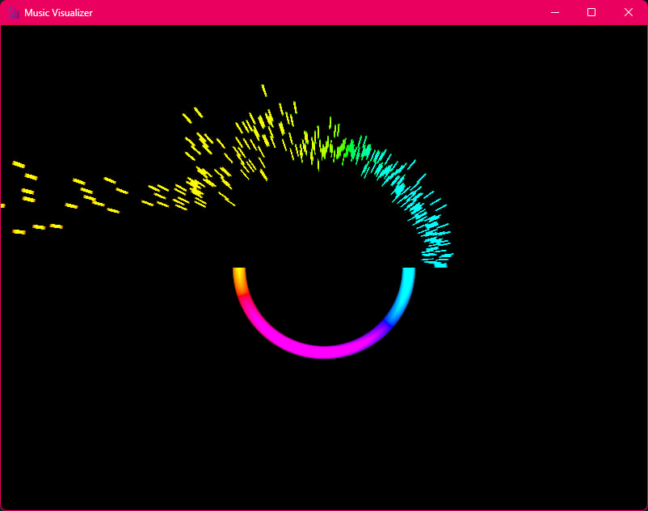 | 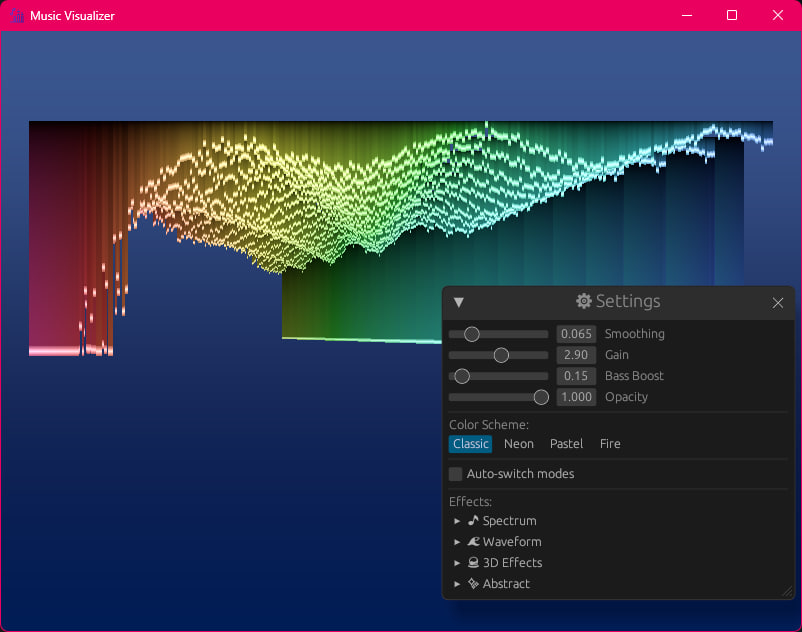 |

## Building from source

Requirements: Windows 10/11, [Rust](https://rustup.rs) (stable, MSVC toolchain), [Bun](https://bun.sh), and the [Tauri prerequisites](https://v2.tauri.app/start/prerequisites/)

```powershell
# Music Visualizer
cd MV; cargo build --release

# Services Manager / NetSentry
cd SM; bun install; bun run tauri build --bundles nsis
cd NS; bun install; bun run tauri build --bundles nsis
```

Release builds create signed update packages, which needs `TAURI_SIGNING_PRIVATE_KEY`. For a local build without the key, put `{"bundle":{"createUpdaterArtifacts":false}}` into a file such as `no-updater.json` and add `--config no-updater.json` to the build command

### Maintainers: release secrets

| Secret | Required | Purpose |
|--------|----------|---------|
| `TAURI_SIGNING_PRIVATE_KEY` | yes, for releases | Signs updater packages (the public key is in `tauri.conf.json`) |
| `TAURI_SIGNING_PRIVATE_KEY_PASSWORD` | yes, for releases | Password of the key above |
| `WINDOWS_CERTIFICATE` | optional | Base64 `.pfx` code-signing certificate, enables Authenticode signing in CI |
| `WINDOWS_CERTIFICATE_PASSWORD` | optional | Password of the `.pfx` |

Losing the updater private key means installed apps can no longer be updated automatically, keep a backup
